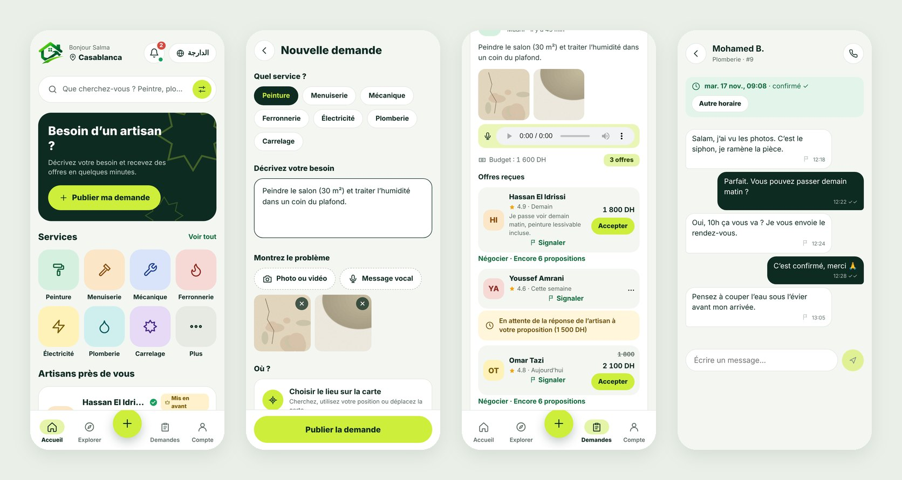
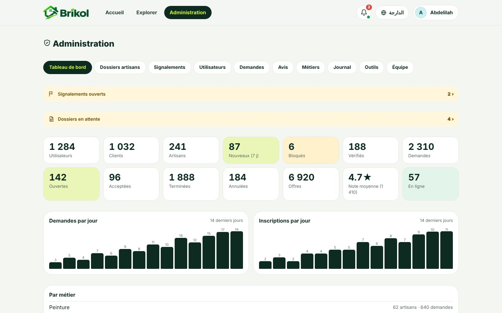
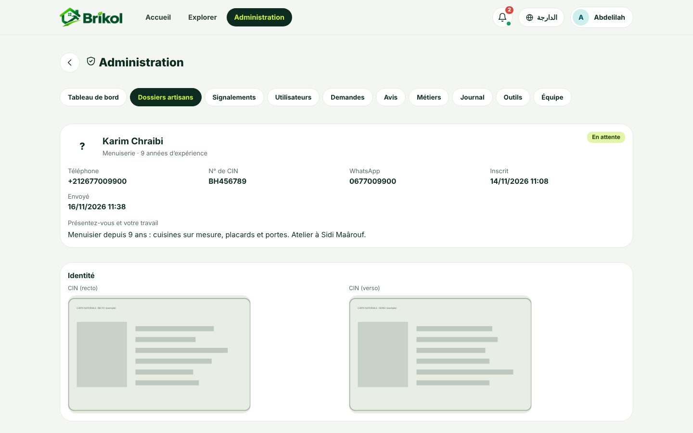
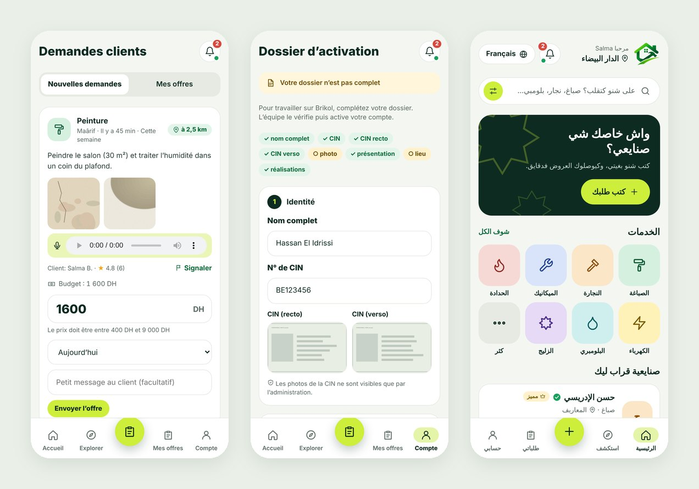
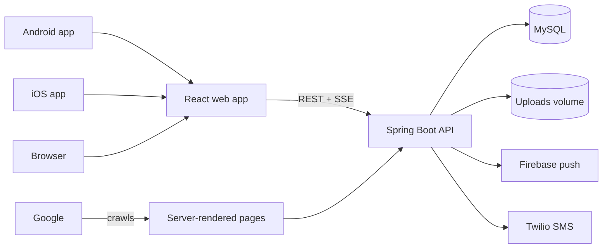

<p align="center">
  
</p>

<p align="center">
  A marketplace for home repairs in Morocco. Clients post a problem, nearby artisans send prices.
  <br>
  <a href="https://snai3i.elguennouni.site">Live site</a> ·
  <a href="docs/SETUP.md">Setup & reference</a> ·
  <a href="deploy/README-DEPLOY.md">Deployment</a>
</p>

<p align="center">
  <a href="https://github.com/elguennouni-dev/brikol/actions/workflows/backend.yml"></a>
  <a href="https://github.com/elguennouni-dev/brikol/actions/workflows/android-check.yml"></a>
</p>



## Why I built this

In Morocco, finding a plumber or a painter usually means asking a neighbour, calling a number written on a wall, or waiting at the *mo9ef* (the corner where day workers gather). You don't know the price until the person is already in your house, and the artisan doesn't know what the job is until he gets there.

Brikol (from *bricoler*, the word everybody uses for small repair jobs) tries to fix that with a simple flow:

1. You take a photo or record a voice note of the problem and say roughly where you are.
2. Artisans of that trade who work in your area see it and send a price.
3. You compare, negotiate if you want, accept one, and chat to set a time.
4. He comes, you pay him in cash, you both leave a review.

The app doesn't touch the payment. Most people here pay cash and that's not going to change because of an app, so I didn't fight it.

The whole UI is in Darija (Arabic script, right-to-left) and French, and you can switch at any moment.

## What it does

**For clients**
- Post a request with photos, a short video or a voice note (a lot of people prefer talking to typing)
- Pick the location on a map, or use the current position
- Get offers live, without refreshing, and counter-offer on the price
- Chat with the artisan once an offer is accepted, and agree on an appointment (with a reminder the day before)
- Rate the artisan, report abuse

**For artisans**
- See only requests for their own trade, inside the radius they chose (5 to 50 km)
- Send a price, negotiate (up to 6 rounds), see how far the job is and how the client was rated by other artisans
- Before getting any work, fill an activation file (CIN front/back, photo, past work, zone) that a person from the team checks

**For the team**
- Dashboard with the numbers that matter (requests per day, signups, per-trade breakdown, live connections)
- Review artisan files, approve or reject with a reason
- Handle reports, block users, edit trades and their price bounds, send broadcasts
- An owner account and staff accounts with only the permissions they need (files, reports, billing…). You can't turn a normal user into an admin; staff are created from the Team tab.
- Every sensitive action is written to an audit log

<table>
  <tr>
    <td></td>
    <td></td>
  </tr>
  <tr>
    <td align="center"><sub>Admin dashboard</sub></td>
    <td align="center"><sub>Reviewing an artisan's activation file</sub></td>
  </tr>
</table>


<p align="center"><sub>Artisan side: matching requests with distance and client rating, the activation file, and the home screen in Darija</sub></p>

## Stack

| | |
|---|---|
| Backend | Java 17, Spring Boot 3, Spring Security (JWT), JPA/Hibernate, Flyway, MySQL 8 (H2 for dev and tests) |
| Web app | React 18 + Vite, no UI kit, hand-written CSS. Leaflet + OpenStreetMap for maps, Photon for address search |
| Mobile | Android (Kotlin) and iOS (SwiftUI) shells around the web app, with native camera, mic, location and push |
| Realtime | Server-Sent Events |
| Notifications | Firebase Cloud Messaging, Twilio for SMS codes |
| Infra | Docker Compose on a VPS behind Nginx, GitHub Actions for tests and the Android build |



The Spring Boot app serves everything: the API, the built React app under `/app/`, and a landing page plus SEO pages at the root. One container, one port, which keeps deployment boring.

## A few things I found interesting to build

**Price range per trade.** When a client types a budget, or an artisan types a price, it has to be inside a range, otherwise you get 5 DH jokes or 500 000 DH typos. Each trade starts with bounds set by the admin. Once there are enough accepted offers for that trade, the range tightens around real prices (from 60% of the 10th percentile to 160% of the 90th). The range is frozen on the request when it's created, so it doesn't move under people mid-negotiation. See `PricingService`.

**Negotiation.** An offer remembers who spoke last, how many rounds happened and the first price. You can only answer when it's your turn, and after 6 rounds it's take it or leave it. Small state machine, but it removed a lot of back and forth in chat.

**Matching and location privacy.** Requests are matched by trade and by haversine distance between the client's pin and the artisan's base, within the artisan's radius (falls back to same city when there are no coordinates). Before an offer is accepted, the artisan only sees the position rounded to about 1 km and no address. The exact place and phone number are revealed only after acceptance.

**Live updates without WebSockets.** New offers, messages and status changes go through one SSE stream per user. Browsers' `EventSource` can't send an `Authorization` header, so the client reads the stream with `fetch` and parses it by hand, and reconnects with backoff. Events are only published after the database transaction commits, so the client never fetches something that isn't there yet.

**Artisan activation.** Artisans have a status (draft, pending, approved, rejected). Until they're approved they can't see any request. ID photos are stored privately and only served to staff who have the FILES permission. Uploaded files are checked by their actual bytes, not by the extension.

**Pages for Google.** A React app is mostly invisible to search engines, so the server also renders plain HTML pages like `/artisans/plomberie/casablanca` and one page per approved artisan, with JSON-LD, a sitemap, and `noindex` on empty pages so we don't publish thin content.

**One frontend, three apps.** The same React bundle runs on the web and inside the Android and iOS shells. The shells add what a WebView can't do well on its own (file pickers with the camera, microphone, push tokens) and pass it to the page through a small JS bridge.

**Rate limiting and abuse.** Login lockout after repeated failures, limits on SMS codes (cooldown and hourly cap), on uploads, chat messages and reports, plus a simple report system that lands in the admin panel.

## Running it locally

You need Java 17, Maven and Node 18+.

```bash
# backend with an in-memory database and demo data
cd backend
mvn spring-boot:run -Dspring-boot.run.profiles=dev
# → http://localhost:8080 (landing) and http://localhost:8080/app/
```

```bash
# web app with hot reload (proxies /api to :8080)
cd frontend
npm install
npm run dev
```

Demo accounts (dev profile only), password `demo1234`:
- client: `0600000001`
- artisan (painter): `0611000001`

SMS, push and Google sign-in are off until you give them credentials. The app works without them (phone + password sign-up). Set `SMS_PROVIDER=log` if you want to try the SMS code flow locally; codes are then printed in the logs.

To run with MySQL instead: `docker compose up --build`. Production deployment (Docker on a VPS, env file, update script) is described in [deploy/README-DEPLOY.md](deploy/README-DEPLOY.md), and every setting is listed in [docs/SETUP.md](docs/SETUP.md).

## Tests

```bash
cd backend && mvn test
```

The tests are mostly end-to-end through the HTTP layer with MockMvc on H2: a full job from request to review, negotiation rules, matching by trade and distance, artisan activation, staff permissions, OTP limits, chat and appointments. They run on every push with GitHub Actions, along with a debug build of the Android app.

## Project layout

```
backend/        Spring Boot API, Flyway migrations, landing page and SEO pages
frontend/       React app (built into backend/src/main/resources/static/app)
mobile/android  Kotlin WebView shell
mobile/ios      SwiftUI WKWebView shell (XcodeGen)
deploy/         production compose file and deploy/update scripts
docs/           setup reference and screenshots
```

## What's next

- Publish the Android app on the Play Store
- Let artisans set availability per day instead of a single "available today" switch
- Better search ranking (distance, rating and response time together)
- Online payment as an option for artisans who want it, never mandatory

## Author

Built by **Abdelilah El Guennouni** ([@elguennouni-dev](https://github.com/elguennouni-dev)). If you're working on something similar in Morocco or have feedback, open an issue, I read them.
